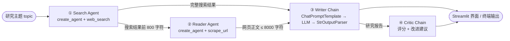

# LangChain Multi-Agent Research System

<p>
  
  
  
  
</p>

> 一个基于 **LangChain v1** 与 **Streamlit** 的多智能体（Multi-Agent）自动化研究系统。
> 输入一个研究主题，系统会自动完成 **联网搜索 → 网页正文抓取 → 结构化报告撰写 → 批判性评审** 四个阶段，并在 Web 界面中展示全部中间产物与最终结果。

---

## 目录

- [项目简介](#项目简介)
- [功能特性](#功能特性)
- [工作原理](#工作原理)
- [技术栈](#技术栈)
- [项目结构](#项目结构)
- [快速开始](#快速开始)
- [使用方法](#使用方法)
- [环境变量](#环境变量)
- [配置与可调参数](#配置与可调参数)
- [常见问题](#常见问题)
- [已知限制](#已知限制)
- [参与贡献](#参与贡献)
- [许可证](#许可证)

---

## 项目简介

`LangChain-Multi-Agent-Research-System` 把「写一份有据可查的研究报告」拆解成四个互相衔接的步骤，每一步交给一个专门的 Agent 或 Chain 负责：

1. **Search Agent** 调用 Tavily 搜索 API，围绕主题检索近期且可靠的信息；
2. **Reader Agent** 从搜索结果中挑选最相关的一个链接，抓取网页并提取正文；
3. **Writer Chain** 把搜索结果与正文汇总成一份带小标题、引用来源的研究报告；
4. **Critic Chain** 以严格的评审视角对报告打分，指出优点与待改进之处。

与「一次性丢给大模型」相比，这种多智能体流水线的优势在于：**检索与写作解耦**、**每一步的输入输出都可检查**、**评审结果可用于自我迭代**。

## 功能特性

- 🤖 **多智能体协作**：检索、阅读、写作、评审四个角色各司其职，基于 LangChain v1 的 `create_agent` 构建。
- 🔍 **实时联网检索**：通过 Tavily Search API 获取 Top-5 搜索结果，包含标题、链接与摘要。
- 📄 **稳健的正文抽取**：`trafilatura` → `readability-lxml` → BeautifulSoup 纯文本，三级回退策略，尽量拿到真正的正文而非导航栏与广告。
- ✍️ **结构化报告生成**：固定输出「引言 / 关键发现 / 结论 / 来源」四段式报告，便于二次加工。
- 🧐 **自动评审打分**：给出 `X/10` 评分、优点、改进建议与一句话结论。
- 🖥️ **Streamlit Web 界面**：侧边栏输入主题，结果以四个 Tab（报告 / 评审 / 搜索结果 / 正文）分栏展示。
- 🔌 **兼容任意 OpenAI 接口**：只需配置 `OPENAI_API_KEY` 与 `OPENAI_API_BASE_URL`，即可接入官方 API、代理网关或本地兼容服务。
- 🧱 **模块化设计**：工具、智能体、流水线三层分离，替换检索源或模型时无需改动上层逻辑。

## 工作原理



| 阶段 | 组件 | 使用的工具 | 产出 |
| --- | --- | --- | --- |
| ① 检索 | `build_search_agent()` | `web_search`（Tavily） | 5 条搜索结果的标题 / 链接 / 摘要 |
| ② 阅读 | `build_reader_agent()` | `scrape_url`（requests + trafilatura） | 页面标题与正文（截断至 8000 字符） |
| ③ 写作 | `writer_chain` | 仅 LLM | Markdown 格式研究报告 |
| ④ 评审 | `critic_chain` | 仅 LLM | 评分、优点、改进建议、结论 |

两个 Agent 都是 **LLM + 工具** 的最小闭环（`create_agent` 内部即「调用模型 → 执行工具 → 再调用模型」的循环），而 Writer / Critic 是纯提示词链（Prompt → LLM → 字符串解析），不涉及工具调用。

## 技术栈

| 分类 | 依赖 | 版本要求 | 用途 |
| --- | --- | --- | --- |
| 智能体框架 | [`langchain`](https://pypi.org/project/langchain/) | `>=1.0.0` | `create_agent`、`@tool` 装饰器 |
| 核心抽象 | [`langchain-core`](https://pypi.org/project/langchain-core/) | `>=1.0.0` | `ChatPromptTemplate`、`StrOutputParser` |
| 模型接入 | [`langchain-openai`](https://pypi.org/project/langchain-openai/) | `>=1.0.0` | `ChatOpenAI`（兼容 OpenAI 协议的服务） |
| Web 界面 | [`streamlit`](https://streamlit.io/) | `>=1.36.0` | 交互式前端 |
| 联网检索 | [`tavily-python`](https://pypi.org/project/tavily-python/) | `>=0.3.0` | Tavily Search API 客户端 |
| 网页抓取 | [`requests`](https://pypi.org/project/requests/) | `>=2.31.0` | 带浏览器 UA 与 15s 超时的 GET 请求 |
| 正文抽取 | [`trafilatura`](https://pypi.org/project/trafilatura/) | `>=1.6.0` | 首选正文提取算法 |
| 正文抽取（回退） | [`readability-lxml`](https://pypi.org/project/readability-lxml/) | `>=0.8.1` | `readability` 回退方案 |
| HTML 解析 | [`beautifulsoup4`](https://pypi.org/project/beautifulsoup4/)、[`lxml`](https://pypi.org/project/lxml/) | `>=4.12.0`、`>=5.0.0` | 标题提取、去标签、解析器后端 |
| 环境变量 | [`python-dotenv`](https://pypi.org/project/python-dotenv/) | `>=1.0.0` | 从 `.env` 读取密钥 |
| 终端输出 | [`rich`](https://pypi.org/project/rich/) | `>=13.7.0` | 命令行下的彩色打印 |

> **为什么必须是 LangChain v1？**
> 项目使用 `from langchain.agents import create_agent`，这是 **LangChain v1.0** 引入的新 API（取代 `langgraph.prebuilt.create_react_agent`）。LangChain 0.x 中不存在该函数，安装旧版本会直接 `ImportError`。

## 项目结构

```text
.
├── app.py                    # Streamlit Web 界面入口（推荐从这里启动）
├── main.py                   # 最小冒烟测试：单独调用 web_search
├── requirements.txt          # Python 依赖清单
├── .env.example              # 环境变量模板（复制为 .env 后填写）
├── demo.excalidraw           # 架构草图（可用 Excalidraw 插件编辑）
├── LICENSE                   # Apache License 2.0
├── src/
│   ├── __init__.py
│   ├── agents/
│   │   └── agents.py         # LLM 初始化、Search/Reader Agent、Writer/Critic 链
│   ├── tools/
│   │   └── tools.py          # web_search 与 scrape_url 两个 @tool
│   └── pipelines/
│       └── pipeline.py       # 四阶段流水线的终端版实现（与 app.py 逻辑一致）
└── .vscode/
    └── settings.json         # 指定 conda 作为 Python 环境管理器
```

## 快速开始

### 前置要求

| 项目 | 要求 |
| --- | --- |
| Python | **3.10 及以上**（推荐 3.11，LangChain v1 的最低版本要求为 3.10） |
| OpenAI 兼容 API | 需要一个能访问 `gpt-4o-mini` 的 Key 与 Base URL |
| Tavily API Key | 免费额度可在 [tavily.com](https://tavily.com) 注册获取 |

### 1. 克隆仓库

```bash
git clone https://github.com/<your-name>/LangChain-Multi-Agent-Research-System.git
cd LangChain-Multi-Agent-Research-System
```

### 2. 创建虚拟环境

使用 conda（Windows / macOS / Linux 均可）：

```bash
conda create -n langagent python=3.11 -y
conda activate langagent
```

或使用标准库 `venv`：

```bash
python -m venv .venv
# Windows (PowerShell)
.\.venv\Scripts\Activate.ps1
# macOS / Linux
source .venv/bin/activate
```

### 3. 安装依赖

```bash
pip install --upgrade pip
pip install -r requirements.txt
```

> 如果你在**已有旧版 LangChain 的环境**中安装，请显式升级，避免残留 0.x：
> ```bash
> pip install -U "langchain>=1.0.0" "langchain-core>=1.0.0" "langchain-openai>=1.0.0"
> ```

### 4. 配置环境变量

```bash
# macOS / Linux
cp .env.example .env

# Windows (PowerShell)
Copy-Item .env.example .env
```

然后编辑 `.env`，填入真实的 Key（变量说明见[环境变量](#环境变量)一节）：

```dotenv
OPENAI_API_BASE_URL="https://api.openai.com/v1"
OPENAI_API_KEY="sk-..."
TAVILY_API_KEY="tvly-..."
```

> ⚠️ `.env` 已被 `.gitignore` 忽略，**请勿把真实密钥提交到仓库**。

### 5. 启动应用

```bash
streamlit run app.py
```

终端会输出访问地址（默认 <http://localhost:8501>）。在侧边栏输入研究主题（如 `Recent advances in RAG`），点击 **Run Research** 即可。

## 使用方法

### Web 界面（推荐）

```bash
streamlit run app.py
```

界面分为四个 Tab：

| Tab | 内容 |
| --- | --- |
| **Final Report** | Writer 生成的完整 Markdown 报告 |
| **Critic Feedback** | 评分、优点、改进建议与结论 |
| **Search Results** | Search Agent 拿到的原始搜索结果 |
| **Scraped Content** | Reader Agent 抓取到的网页正文 |

运行过程中每一步都有加载提示（`st.spinner`）；出现异常时页面会以红色错误框展示原因。

### 在 Python 中调用

```python
from src.pipelines.pipeline import run_research_pipeline

state = run_research_pipeline("大模型在医疗诊断中的最新进展")

print(state["report"])     # 结构化研究报告
print(state["feedback"])   # 评审意见
print(state["scraped_content"])  # 抓取到的网页正文
```

`run_research_pipeline(topic: str) -> dict` 返回的字典包含四个键：

| 键 | 类型 | 含义 |
| --- | --- | --- |
| `search_results` | `str` | 搜索结果拼接文本 |
| `scraped_content` | `str` | 抓取到的正文 |
| `report` | `str` | 最终报告 |
| `feedback` | `str` | 评审反馈 |

> 注意：流水线是**同步阻塞**的，单次运行通常需要数十秒，取决于模型与搜索接口的响应速度。

### 冒烟测试（验证密钥是否可用）

```bash
python main.py
```

该脚本只调用一次 `web_search` 并打印结果，用于快速排查 Tavily Key 与网络问题，不消耗 LLM 额度。

## 环境变量

程序通过 `python-dotenv` 从项目根目录的 `.env` 读取配置：

| 变量名 | 必填 | 说明 | 示例 |
| --- | --- | --- | --- |
| `OPENAI_API_BASE_URL` | ✅ | OpenAI 兼容接口的 Base URL，通常以 `/v1` 结尾 | `https://api.openai.com/v1` |
| `OPENAI_API_KEY` | ✅ | 接口鉴权密钥 | `sk-...` |
| `TAVILY_API_KEY` | ✅ | Tavily 搜索 API 密钥 | `tvly-...` |

## 配置与可调参数

以下参数目前**写在代码里**，按需修改即可：

| 参数 | 位置 | 默认值 | 说明 |
| --- | --- | --- | --- |
| 模型名称 | `src/agents/agents.py:14` | `gpt-4o-mini` | 换成 `gpt-4o`、`deepseek-chat` 等任意兼容模型 |
| 温度 | `src/agents/agents.py:15` | `0` | 研究报告场景建议保持低温度 |
| 搜索结果数量 | `src/tools/tools.py:27` | `5` | `tavily.search(max_results=5)` |
| 摘要截断长度 | `src/tools/tools.py:31` | `30` 字符 | 摘要过长时可调大 |
| 抓取超时 | `src/tools/tools.py:54` | `15` 秒 | 目标站点较慢时可调大 |
| 正文截断长度 | `src/tools/tools.py:82` | `8000` 字符 | 受模型上下文限制，不建议无限放大 |
| 传给 Reader 的搜索上下文 | `app.py:31` | `800` 字符 | 搜索结果过长时只截取前 800 字符 |
| 报告章节结构 | `src/agents/agents.py:45-51` | 引言 / 关键发现 / 结论 / 来源 | 修改提示词即可定制 |
| 评审输出格式 | `src/agents/agents.py:64-75` | 评分 / 优点 / 改进 / 结论 | 同上 |

## 常见问题

<details>
<summary><b>启动时报 <code>Did not find openai_api_key</code></b></summary>

`ChatOpenAI` 在实例化时就会校验密钥。请确认：

1. `.env` 位于**项目根目录**（与 `app.py` 同级），而不是 `src/` 下；
2. 变量名拼写正确，且**没有多余空格**（`python-dotenv` 会容忍两侧空格，但引号内不要混入空格）；
3. 修改 `.env` 后**重启** Streamlit 进程。
</details>

<details>
<summary><b>报 404 / model not found</b></summary>

检查 `OPENAI_API_BASE_URL` 是否以 `/v1` 结尾，且该网关确实提供 `gpt-4o-mini` 模型。部分代理只开放特定模型，此时请同步修改 `src/agents/agents.py` 中的 `model_name`。
</details>

<details>
<summary><b>Tavily 返回 401 / 429 / 额度不足</b></summary>

401 表示 Key 无效（注意 `tvly-` 前缀）；429 表示触发速率限制。可先运行 `python main.py` 单独验证搜索链路，避免把 LLM 错误与搜索错误混在一起排查。
</details>

<details>
<summary><b>抓取结果为空或 <code>Failed to fetch ...</code></b></summary>

常见原因：目标站点有反爬策略、内容是 JavaScript 动态渲染、或请求超时。`scrape_url` 采用三级回退抽取，已尽力兼容静态页面；对于纯 JS 站点，需要额外接入 Playwright 之类的渲染方案。
</details>

<details>
<summary><b>Streamlit 端口被占用</b></summary>

```bash
streamlit run app.py --server.port 8502
```
</details>

<details>
<summary><b>网络受限，无法访问 OpenAI 或 Tavily</b></summary>

两种方式任选其一：配置系统代理（`HTTPS_PROXY` / `HTTP_PROXY`），或把 `OPENAI_API_BASE_URL` 指向可用的中转网关。注意不要把密钥硬编码进代码。
</details>

## 已知限制

- **无缓存与持久化**：每次运行都会重新搜索、抓取与生成，重复执行会重复计费。
- **串行执行**：四个阶段依次进行，且 Reader Agent 只抓取**一个** URL，覆盖面有限。
- **上下文截断**：搜索摘要仅保留 30 字符、传给 Reader 的结果仅 800 字符、正文上限 8000 字符，长文信息会丢失。
- **无重试与回退模型**：接口偶发失败会直接抛出异常（Web 界面会捕获并展示）。
- **模型与提示词硬编码**：未提供配置文件或 UI 调节入口。
- **暂无自动化测试**：仅提供 `main.py` 冒烟测试。

## 参与贡献

欢迎提交 Issue 与 Pull Request：

1. Fork 本仓库并创建分支：`git checkout -b feature/your-feature`；
2. 保持代码风格与现有模块分层一致（`tools` / `agents` / `pipelines`）；
3. 提交前请确保 `python main.py` 与 `streamlit run app.py` 均能正常启动；
4. 提交 PR 时说明动机、改动点与验证方式。

**适合上手的改进方向**

- [ ] 支持一次抓取多个 URL 并做去重、去广告
- [ ] 增加结果缓存（按 topic + URL 命中），降低成本
- [ ] 把模型、温度、检索条数抽到 `.env` 或界面配置项
- [ ] 为 `web_search` / `scrape_url` 补充单元测试与失败重试
- [ ] 支持导出报告为 Markdown / PDF 文件

## 许可证

本项目基于 [Apache License 2.0](LICENSE) 开源。

## 致谢

本项目构建于以下优秀的开源项目之上：[LangChain](https://github.com/langchain-ai/langchain)、[Streamlit](https://github.com/streamlit/streamlit)、[Tavily](https://tavily.com)、[trafilatura](https://github.com/adbar/trafilatura)、[readability-lxml](https://github.com/buriy/python-readability)、[Beautiful Soup](https://www.crummy.com/software/BeautifulSoup/)。
